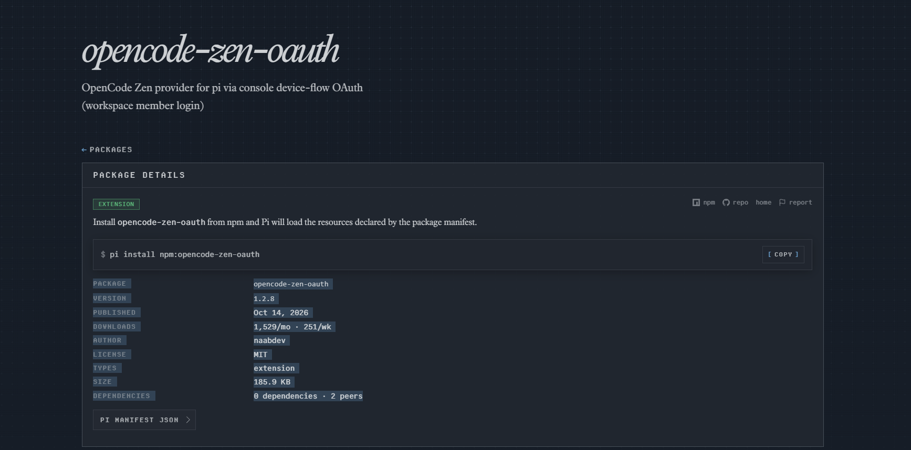

# opencode-zen-oauth

[](https://pi.dev/packages/opencode-zen-oauth?name=opencode-zen-oauth)

[](https://pi.dev/packages/opencode-zen-oauth?name=opencode-zen-oauth)

**English** | [Tiếng Việt](./README.vi.md)

OpenCode Zen inside pi — no API keys. Workspace members can finally use Zen too.

## Install

```sh
pi install npm:opencode-zen-oauth
```

## Why

OpenCode's v2 console hides API keys from workspace members, and raw OAuth
tokens get rejected outside the official client. Three walls, one extension:

1. **No keys to manage.** `/login opencode-zen` opens a device-code page, you
   approve once in the browser, pi stores and refreshes the token itself.
2. **Workspace-safe.** Pick your workspace in the pi TUI after approval
   (leave the web page on "All workspaces"). Every request carries the
   matching org header, and `/model` only lists what that workspace allows.
3. **Catalog that keeps up.** The model list refreshes from the workspace
   itself — disabled models and admin whitelists respected, context limits
   and per-million-token prices mapped automatically.

## Login flow

```
/login opencode-zen        # device code + link appears in the TUI
```

Approve in the browser, come back to the terminal, pick a workspace, done.
Models appear under `opencode-zen/` in `/model`. No opencode install needed —
everything runs over HTTPS against `opencode.ai`.

Fallback: set `OPENCODE_API_KEY` to use a Zen API key instead of OAuth.

## Models

Live example from a real workspace (your list depends on your workspace):

| id | input | output | cache read | inputs |
|----|-------|--------|------------|--------|
| `glm-5.3-flash` | $0.15 | $0.50 | $0.03 | text, image |
| `deepseek-v4.1-flash` | $0.30 | $1.20 | $0.006 | text, image |
| `big-pickle` | $0 | $0 | $0 | text |
| `muse-spark-1.3-contributor-free` | $0 | $0 | $0 | text, image |

Prices per million tokens, billed to the selected workspace. Zero-cost rows
are the Zen free tier: the extension satisfies the gateway's content gate
(marker prompt + history shape, `src/v2-gate.ts`) and runs tool calling as a
text protocol on those models.

## Security

- The extension never prints or logs your token or workspace ID.
- Do not paste your token or workspace ID into chat yourself — pi session
  files persist what you type. If one leaks, revoke it in the OpenCode
  console and run `/login opencode-zen` again.

## Layout

- `index.ts` — entry point pi loads; re-exports `src/extension.ts`
- `src/extension.ts` — provider assembly and registration
- `src/auth.ts` — device-flow login, workspace selection, token refresh
- `src/models.ts` — console-to-pi model mapping, per-route wire protocols
- `src/free-tier.ts` — free-tier identity headers per request
- `src/v2-gate.ts` — free-tier content gate: marker prompt, history shape, text-protocol tools
- `test/` — bun test suite with mocked fetch (`bun test`)

## License

MIT

## Changelog

See [CHANGELOG.md](./CHANGELOG.md) and
[GitHub releases](https://github.com/Naab2k3/pi-opencode-zen/releases).
